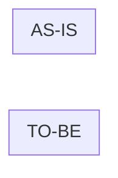

<!-- 구조 설명이 필요한 변경이면 맨 위에 쉬운 설명 링크를 둔다: 📖 [이 PR 쉽게 설명 (eli5)](URL) -->

## 관련 이슈

- closes #

## 변경 요약

-

## 스펙

- [ ] `docs/` 스펙 갱신 (동작 변경이 없으면 사유: )
- 추가·변경된 요구사항 ID:
- 추가·변경된 TC:

## 검증

- [ ] 검증 명령 (`CLAUDE.md` "검증")
- [ ] 보안 경계 mutation 확인 (해당 시): 지운 조건 → 실패한 테스트
- [ ] 실기기·통합 확인 (해당 시): 확인한 환경 / 확인하지 못한 것

## 후속 이슈

<!-- 이 PR 에서 처리하지 않고 미룬 것과 확인하지 못한 것의 이슈 번호. 없으면 "없음." -->

-

## 구조 변경 (해당 시)

